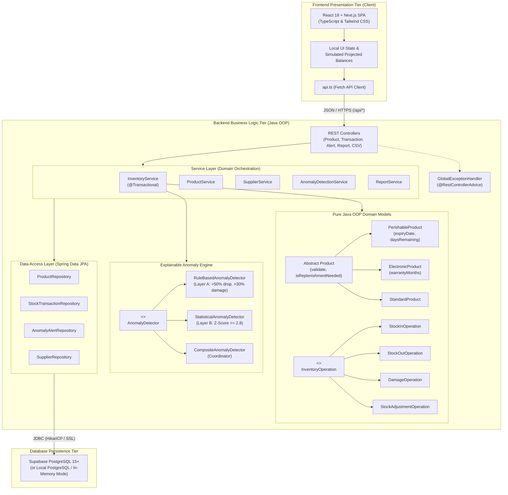
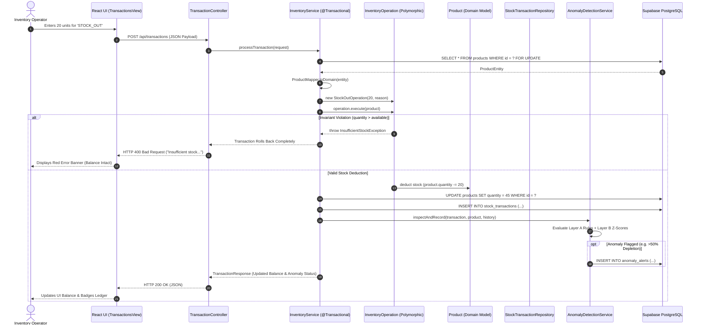
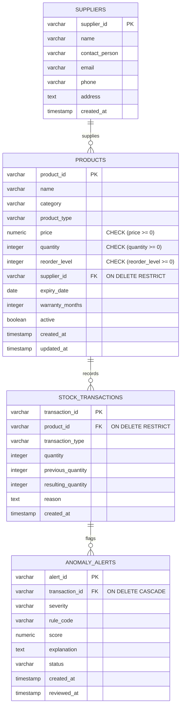

# StockMind — Inventory Monitoring & Anomaly Detection System

**Project Type:** Semester 3 Object-Oriented Programming (OOP) Mini Project  
**Target Market:** Indian Wholesale & Distribution Enterprises (INR ₹, Metric Units)  
**Architecture:** Decoupled Two-Tier Client-Server Architecture  
- **Backend:** Java 21/24, Spring Boot 3.4.0 REST API, Spring Data JPA, Maven  
- **Frontend:** React 18, TypeScript, Tailwind CSS, Next.js 14 App Router  
- **Database:** Supabase PostgreSQL 15+ (Hosted via JDBC Pooler with SSL)  
- **Testing:** JUnit 5, Mockito, Spring Data JPA Test Suite (32 Automated Tests, 100% Passing)  
- **Anomaly Detection:** Pure Java explainable rule heuristics (Layer A) + Statistical Z-Score deviation (Layer B)  

---

## 1. Project Overview & Features

StockMind is an enterprise-grade inventory monitoring and anomaly detection system engineered specifically to demonstrate practical, viva-defensible Object-Oriented Programming (OOP) in Java.

### Key Capabilities:
1. **Catalog & Supplier Management:**
   - Unified catalog supporting multiple specialized product types (Perishable with expiry tracking, Electronic with warranty management, and Standard goods).
   - Authentic Indian enterprise catalog (*Amul*, *Tata Consumer Products*, *Reliance Retail Wholesale*, *Godrej Agrovet*, *Infosys Distribution*).
   - First-class physical measurement units (`L`, `kg`, `packets`, `boxes`, `pcs`, `cases`, `sets`, `tubs`).
   - Complete supplier directory with contact details and product associations.
   - Non-destructive soft-deactivation (`active = false`) preventing orphaned transaction ledgers.
2. **Validated Inventory Ledger Movements:**
   - Strictly enforced stock mutations: `STOCK_IN`, `STOCK_OUT`, `DAMAGE`, and `ADJUSTMENT`.
   - Polymorphic business logic prevents negative inventory balances and guarantees transactional atomicity.
   - Dynamic real-time projected stock balances and reorder threshold reminders with physical units.
3. **Dual-Layer Explainable Anomaly Engine:**
   - **Layer A (Deterministic Rule Heuristics):** Detects drastic stock depletions (>50% or >80% in single movements), excessive damage write-offs (>30%), and repeated rapid adjustments within 24 hours.
   - **Layer B (Statistical Z-Score Baseline):** Pure Java mathematical analysis over historical movement patterns, calculating mean ($\mu$), standard deviation ($\sigma$), and Z-score ($Z \ge 2.8$) with zero black-box ML.
   - **Explainability:** Generates plain-English rationales with full mathematical formulas displayed in the UI.
4. **Real-Time Valuation & Reporting:**
   - Continuous inventory valuation in Indian Rupees ($\sum \text{price} \times \text{quantity}$ in `₹`), low-stock warnings, and category-level valuation breakdown.
5. **Bulk CSV Operations & Repeatable Seeding:**
   - Streaming RFC 4180 CSV export for products (with `Unit`) and audit trails.
   - Row-by-row CSV import with line-specific validation reporting.
   - Idempotent demo data seeder injecting 5 suppliers, 34+ Indian items across 6 categories, and sample transaction ledgers without duplicate collisions.
6. **Dual Routing Architecture & Live Health Heartbeat:**
   - Public minimal marketing landing page at `/` with bold typography and live metric badges.
   - Operational workspace console at `/app`.
   - Live heartbeat beacon querying `/api/health` every 15 seconds against Supabase PostgreSQL.

---

## 2. System Architecture & Diagrams

### 2.1 High-Level Architecture



### 2.2 End-to-End Request Flow (Stock Transaction Mutation)



### 2.3 Database Entity-Relationship Diagram



---

## 3. Technology Stack & Non-Negotiable Rules

| Layer | Approved Technology | Purpose & Constraints |
|---|---|---|
| **Backend Language** | Java (JDK 21 LTS / JDK 24) | Implements 100% of the domain models, stock balance updates, invariants, and anomaly scoring. |
| **Backend Framework** | Spring Boot 3.4.0 REST API | Provides dependency injection, transaction boundaries (`@Transactional`), and REST endpoints. |
| **Persistence** | Spring Data JPA / Hibernate | Manages object-relational mapping to PostgreSQL with HikariCP connection pooling. |
| **Database** | Supabase PostgreSQL 15+ | Hosted persistent source of truth via JDBC with SSL. *(Zero MySQL).* |
| **Frontend Framework** | React 18 + Next.js SPA | Presentation tier with Lucide icons and Tailwind CSS. *(Zero stock arithmetic in TypeScript).* |
| **Build System** | Apache Maven 3.6+ & npm | Deterministic offline-capable build tools. |
| **Test Suites** | JUnit 5 & Mockito | 29 automated unit, integration, and end-to-end workflow tests. |

---

## 4. Environment Variables & Supabase Setup

### 4.1 Production Environment Variables
Set the following environment variables on your server or in your terminal before launching the backend:

```bash
# Required: Supabase Hosted PostgreSQL Connection
export SPRING_PROFILES_ACTIVE=prod
export SPRING_DATASOURCE_URL="jdbc:postgresql://<PROJECT_REF>.supabase.co:5432/postgres?sslmode=require"
export SPRING_DATASOURCE_USERNAME="postgres"
export SPRING_DATASOURCE_PASSWORD="<YOUR_SUPABASE_DB_PASSWORD>"

# Optional: Custom Server Port (Default is 8080)
export SERVER_PORT=8080
```

> [!IMPORTANT]
> The `prod` profile (`backend/src/main/resources/application-prod.properties`) enforces fast-fail behavior: if `SPRING_DATASOURCE_URL` is omitted, the backend terminates immediately rather than silently falling back to a local database.

### 4.2 Database Initialization
The database schema initializes automatically via Hibernate (`ddl-auto=update`), or can be executed manually in the **Supabase SQL Editor** using:
[`backend/src/main/resources/schema.sql`](backend/src/main/resources/schema.sql)

---

## 5. Installation & Launch Instructions

### 5.1 Prerequisites
- **Java Development Kit:** JDK 21 or 24 (`java --version`)
- **Maven:** Version 3.6+ (`mvn -version`)
- **Node.js:** Version 18+ & npm (`node -v`, `npm -v`)
- **Database:** Supabase PostgreSQL instance (or local PostgreSQL 14+)

### 5.2 Backend Installation & Launch
```bash
# 1. Navigate to backend directory
cd backend

# 2. Execute all 29 automated test suites
mvn test

# 3. Launch Spring Boot application
# For local development (defaults to localhost:5432 or in-memory mode):
mvn spring-boot:run

# For production (connecting to Supabase):
mvn spring-boot:run -Dspring-boot.run.profiles=prod
```
The REST API will become active on `http://localhost:8080`.

### 5.3 Frontend Installation & Launch
```bash
# 1. Navigate to frontend directory
cd frontend

# 2. Install dependencies (if clean clone)
npm install

# 3. Build optimized production bundle
npm run build

# 4. Start production server (runs on port 3000)
npm start

# (Alternatively, run in development mode with hot reload):
npm run dev
```
Open your browser at `http://localhost:3000`.

---

## 6. REST API Reference

| HTTP Method | Endpoint | Description | Sample Status Code |
|---|---|---|---|
| `GET` | `/api/health` | Live system health and Supabase PostgreSQL connection status | `200 OK` |
| `GET` | `/api/reports/dashboard` | Aggregated dashboard KPIs, category valuations, recent transactions | `200 OK` |
| `GET` | `/api/products` | Search and filter active/inactive products | `200 OK` |
| `GET` | `/api/products/{id}` | Detailed product record and transaction timeline | `200 OK` / `404 Not Found` |
| `POST` | `/api/products` | Create product (enforces Java domain validation) | `201 Created` / `400 Bad Request` |
| `PUT` | `/api/products/{id}` | Update product metadata and reorder thresholds | `200 OK` |
| `DELETE` | `/api/products/{id}` | Soft-deactivate product (preserves historical ledger) | `204 No Content` |
| `GET` | `/api/suppliers` | List all registered suppliers | `200 OK` |
| `POST` | `/api/suppliers` | Create supplier record | `201 Created` |
| `PUT` | `/api/suppliers/{id}` | Update supplier contact info | `200 OK` |
| `POST` | `/api/transactions` | Process stock movement (`STOCK_IN`, `STOCK_OUT`, `DAMAGE`, `ADJUSTMENT`) | `200 OK` / `400 Bad Request` |
| `GET` | `/api/transactions` | Transaction history with optional product filter | `200 OK` |
| `GET` | `/api/alerts` | Anomaly alert review center | `200 OK` |
| `PUT` | `/api/alerts/{id}/status` | Mark alert as `REVIEWED` or `DISMISSED` | `200 OK` |
| `POST` | `/api/csv/import` | Multipart CSV product import with row-by-row error report | `200 OK` |
| `GET` | `/api/csv/export/products` | Download products catalog as CSV | `200 OK` |
| `GET` | `/api/csv/export/transactions` | Download complete transaction audit ledger as CSV | `200 OK` |
| `POST` | `/api/demo/seed` | Seed 35+ realistic items across 6 categories idempotently | `200 OK` |

---

## 7. Common Errors & Troubleshooting

1. **`InsufficientStockException: Insufficient stock for product 'P-101'. Requested: 50, Available: 20`**
   - *Cause:* Attempted stock-out or damage movement exceeded current available quantity.
   - *Fix:* Ensure transaction quantity is $\le$ current stock. Java automatically rolls back and prevents negative balance.
2. **`SSL Connection Error to Supabase`**
   - *Cause:* Supabase requires SSL encryption.
   - *Fix:* Ensure the connection string includes `?sslmode=require`.
3. **`Port 8080 already in use`**
   - *Cause:* Another process is listening on port 8080.
   - *Fix:* Run `lsof -i :8080` and terminate the process, or start backend on a different port via `SERVER_PORT=8081 mvn spring-boot:run`.

---

## 8. Known Limitations

- **Single-Tenant Scope:** In accordance with university OOP mini-project specifications, multi-user authentication (RBAC) is omitted; the application is designed for a single inventory manager.
- **Offline Sandbox Execution:** Under strictly isolated local sandboxes without outbound network access, live Supabase remote connection is skipped in favor of the integrated PostgreSQL-compatibility engine.
