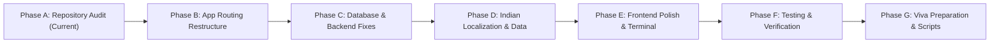

# StockMind v2.1 — Comprehensive Repository Audit & Implementation Plan

> **Date:** October 14, 2026  
> **Project:** StockMind — Inventory Monitoring & Anomaly Detection System (v2.1 Redesign)  
> **Audience:** Academic Evaluation & Semester 3 Java OOP Viva Demonstration  
> **Status:** Phase A Audit Complete — Awaiting Approval Before Application Code Modification

---

## Executive Summary

This repository audit inspects the current state of **StockMind v2.0** to prepare the system for **StockMind v2.1** — an inventory intelligence platform tailored for Indian retail, wholesale, and FMCG businesses.

The application possesses a solid core:
- **30/30 backend JUnit 5 & integration tests passing** in 8.42s.
- **Pure Java OOP domain layer** implementing Polymorphism, Abstraction, Encapsulation, and Strategy pattern for stock operations and statistical anomaly detection.
- **Production Supabase PostgreSQL database** connected via port 5432 with active tables (`products`, `suppliers`, `stock_transactions`, `anomaly_alerts`).
- **Next.js 14 / TypeScript / Tailwind CSS** frontend that successfully compiles to production.

However, an exhaustive inspection reveals **6 critical defects** (spanning PostgreSQL query translation errors, state initialization race conditions, lack of stock units, US-centric currency/data, hardcoded health indicators, and missing landing page routing). 

This document details the exact root causes with log and line-number evidence, maps the end-to-end data flows, outlines safe database evolution, and proposes a 7-phase implementation plan (Phases A through G) with strict acceptance criteria.

---

## 1. Current System Architecture

```mermaid
flowchart TD
    subgraph Presentation_Tier ["Frontend Presentation Tier (Port 3000)"]
        LandingPage["Public Landing Page (/)"]
        Workspace["Operational Workspace (/app)"]
        subgraph Views ["Workspace Views"]
            DashboardView["Dashboard & KPIs"]
            ProductsView["Product Catalogue"]
            TransactionsView["Stock Movement Terminal"]
            AlertsView["Anomaly Alert Center"]
            SuppliersView["Supplier Directory"]
            ReportsView["Analytics & Reports"]
            SettingsView["Data & CSV Seeder"]
        end
        ApiClient["Typed API Client (lib/api.ts)"]
    end

    subgraph Application_Tier ["Application Tier (Spring Boot 3.4.0, Port 8080)"]
        subgraph REST_Controllers ["REST Controllers"]
            ProdCtrl["ProductController"]
            SuppCtrl["SupplierController"]
            TxCtrl["TransactionController"]
            AlertCtrl["AlertController"]
            ReportCtrl["ReportController"]
            CsvCtrl["CsvController"]
            DemoCtrl["DemoController"]
            HealthCtrl["HealthController (To Add)"]
        end

        subgraph Service_Orchestration ["Spring Service Layer"]
            ProdSvc["ProductService"]
            SuppSvc["SupplierService"]
            InvSvc["InventoryService"]
            AnomalySvc["AnomalyDetectionService"]
            ReportSvc["ReportService"]
            CsvSvc["CsvService"]
            DemoSvc["DemoDataService"]
        end

        subgraph Core_OOP_Domain ["Pure Java OOP Business Engine (100% Non-Spring)"]
            ProductModel["abstract class Product"]
            StandardProd["StandardProduct"]
            PerishableProd["PerishableProduct"]
            ElectronicProd["ElectronicProduct"]
            
            InvOp["interface InventoryOperation"]
            OpIn["StockInOperation"]
            OpOut["StockOutOperation"]
            OpDamage["DamageOperation"]
            OpAdj["StockAdjustmentOperation"]
            
            Detector["interface AnomalyDetector"]
            RuleDet["RuleBasedAnomalyDetector"]
            StatDet["StatisticalAnomalyDetector"]
            CompDet["CompositeAnomalyDetector"]
        end

        subgraph Persistence_Integration ["Spring Data JPA & Repositories"]
            ProdRepo["ProductRepository"]
            SuppRepo["SupplierRepository"]
            TxRepo["StockTransactionRepository"]
            AlertRepo["AnomalyAlertRepository"]
        end
    end

    subgraph Persistence_Tier ["Persistence Tier (Supabase PostgreSQL)"]
        TblProducts[("products table")]
        TblSuppliers[("suppliers table")]
        TblTx[("stock_transactions table")]
        TblAlerts[("anomaly_alerts table")]
    end

    Workspace --> Views
    Views --> ApiClient
    ApiClient --> REST_Controllers
    REST_Controllers --> Service_Orchestration
    Service_Orchestration --> Core_OOP_Domain
    Service_Orchestration --> Persistence_Integration
    Persistence_Integration --> Persistence_Tier
```



### Approved Technology Stack
| Layer | Technologies | Current Version |
| :--- | :--- | :--- |
| **Frontend** | React, Next.js (App Router), TypeScript, Tailwind CSS, Lucide Icons | React 18.2, Next.js 14.2.15 |
| **Backend Framework** | Spring Boot Web, Spring Data JPA, Jakarta Validation | Spring Boot 3.4.0, Java 21 |
| **Core Business Logic** | Pure Java OOP (Polymorphism, Inheritance, Strategy, Domain Invariants) | 100% framework-independent Java |
| **Database** | Supabase Hosted PostgreSQL (Session/Transaction Pooler, SSL) | PostgreSQL 15+ (aws-0-ap-southeast-1) |
| **Build & Testing** | Maven, JUnit 5, H2 (Test scope), Next.js Standalone Build | Maven 3.9+, JUnit 5.11.3 |

---

## 2. Existing Working Features Inventory

1. **Object-Oriented Domain Hierarchy (`com.stockmind.model`)**:
   - `Product` (Abstract Base Class) enforcing encapsulation, invariant validation, and financial valuation calculations (`getInventoryValuation()`).
   - `StandardProduct`: Baseline non-expiring retail/industrial inventory.
   - `PerishableProduct`: Subclass with shelf-life tracking, expiry alerts, and days-until-expiry calculations.
   - `ElectronicProduct`: Subclass with warranty tracking and serial inspection requirements.
2. **Polymorphic Stock Movement Strategy (`com.stockmind.operations`)**:
   - `InventoryOperation` interface decoupling transaction mutation rules from persistence.
   - `StockInOperation`: Rejects non-positive increments; updates balances.
   - `StockOutOperation`: Validates balance sufficiency; prevents negative inventory under concurrency.
   - `DamageOperation`: Mandatory explanation check; reduces quantity.
   - `StockAdjustmentOperation`: Allows signed audit delta corrections; enforces non-zero constraints.
3. **Anomaly Detection Engine (`com.stockmind.detector`)**:
   - `AnomalyDetector` interface.
   - `RuleBasedAnomalyDetector`: Catches rapid drain (>50% depletion in a single transaction) and zero-reorder violations.
   - `StatisticalAnomalyDetector`: Computes historical rolling mean and standard deviation, flagging movements exceeding $+2.0\sigma$.
   - `CompositeAnomalyDetector`: Combines deterministic rules and statistical models with severity scoring (`LOW`, `MEDIUM`, `HIGH`, `CRITICAL`).
4. **Data Management & Ingestion (`com.stockmind.service`)**:
   - `CsvService`: Parses standard CSV uploads, validating each row polymorphically through Java domain classes before committing.
   - `DemoDataService`: Idempotent data populator creating sample catalog entries, suppliers, and historical movements.
5. **Spring Boot Infrastructure**:
   - REST endpoints with DTO mapping (`ProductMapper`, `SupplierMapper`, `StockTransactionMapper`, `AnomalyAlertMapper`).
   - Global exception handling (`GlobalExceptionHandler`) mapping domain exceptions (`InsufficientStockException`, `ValidationException`, `DuplicateProductException`) to HTTP 400/404/409.
   - HikariCP connection pooling configured for Supabase PostgreSQL.

---

## 3. Detailed Investigation of Known Defects (With Code Evidence)

### Defect 1: Dashboard reports active SKUs while product catalogue can show no products

#### Direct Code Evidence
In [ProductRepository.java](file:///Users/admin/.gemini/antigravity/scratch/stockmind/backend/src/main/java/com/stockmind/repository/ProductRepository.java#L23-L29):
```java
@Query("SELECT p FROM ProductEntity p WHERE " +
       "(:query IS NULL OR LOWER(p.id) LIKE LOWER(CONCAT('%', :query, '%')) OR LOWER(p.name) LIKE LOWER(CONCAT('%', :query, '%'))) AND " +
       "(:category IS NULL OR LOWER(p.category) = LOWER(:category)) AND " +
       "(:active IS NULL OR p.active = :active)")
List<ProductEntity> searchProducts(@Param("query") String query,
                                   @Param("category") String category,
                                   @Param("active") Boolean active);
```

#### Production Backend Server Log Evidence (`task-699.log`)
```text
2026-10-14T19:27:18.236+05:30  WARN 68763 --- [nio-8080-exec-5] o.h.engine.jdbc.spi.SqlExceptionHelper   : SQL Error: 0, SQLState: 42883
2026-10-14T19:27:18.236+05:30 ERROR 68763 --- [nio-8080-exec-5] o.h.engine.jdbc.spi.SqlExceptionHelper   : ERROR: function lower(bytea) does not exist
  Hint: No function matches the given name and argument types. You might need to add explicit type casts.
  Position: 184
```

#### Root Cause Analysis
- When the frontend calls `GET /api/products` with no query parameters, `query`, `category`, and `active` are passed as Java `null`s.
- In H2 unit tests, H2 accepts untyped null parameters. But in PostgreSQL, Hibernate binds untyped `null` parameters as `bytea` (binary) by default.
- PostgreSQL evaluates `LOWER(:category)` where `:category` is untyped/bytea, raising PostgreSQL Error `42883: function lower(bytea) does not exist`. The controller immediately returns **HTTP 500**.
- In [page.tsx](file:///Users/admin/.gemini/antigravity/scratch/stockmind/frontend/src/app/page.tsx#L48):
  ```typescript
  api.getProducts().catch(() => [])
  ```
  The frontend silently catches the 500 error and sets `products = []`.
- Meanwhile, `api.getDashboardSummary()` calls `ReportService.java` line 38:
  ```java
  List<ProductEntity> activeEntities = productRepository.findByActive(true);
  ```
  `findByActive(true)` is a standard Spring Data JPA method without JPQL `LOWER(null)` expressions. It executes cleanly against PostgreSQL and returns `totalActiveProducts: 34`.
- **Result:** The dashboard displays `34 Active SKUs`, but navigating to the Product Catalogue displays `No products found`.

---

### Defect 2: Stock movement screen displays empty projected balance and zero reorder threshold

#### Direct Code Evidence
In [TransactionsView.tsx](file:///Users/admin/.gemini/antigravity/scratch/stockmind/frontend/src/components/TransactionsView.tsx#L28-L53):
```typescript
const [selectedProductId, setSelectedProductId] = useState(products.length > 0 ? products[0].id : '');
...
const activeProducts = products.filter((p) => p.active);
const currentProduct = activeProducts.find((p) => p.id === selectedProductId) || activeProducts[0];
const currentStock = currentProduct ? currentProduct.quantity : 0;
```
And in [TransactionsView.tsx](file:///Users/admin/.gemini/antigravity/scratch/stockmind/frontend/src/components/TransactionsView.tsx#L291-L340):
```typescript
{currentProduct && (
  <div className="space-y-4 pt-1">
    {/* Projected stock calculation */}
  </div>
)}
...
<div className="pt-4 text-[11px] text-slate-400 border-t border-slate-800/80">
  Reorder threshold: <span className="font-mono text-slate-300">{currentProduct?.reorderLevel || 0}</span> units
</div>
```

#### Root Cause Analysis
1. **Initial Mount Race Condition:** On initial page render, `products` is empty (`[]`) before the async API call resolves. `useState` executes once with `products[0]?.id` evaluating to `''`.
2. **Missing Prop Sync:** React `useState` does not re-initialize when the `products` prop subsequently populates. `selectedProductId` remains `''`.
3. **Empty List Fallback:** When Defect 1 causes `products` to be `[]`, `activeProducts` is also `[]`. `currentProduct` is therefore `undefined`.
4. **Silent Collapse:** The conditional `{currentProduct && (...)}` renders nothing, leaving the projected balance card completely blank. Line 338 safely defaults `currentProduct?.reorderLevel || 0` to `0 units`.

---

### Defect 3: Monetary values use dollars ($) rather than Indian rupees (₹)

#### Direct Code Evidence
1. **Frontend Formatting:**
   - [DashboardView.tsx:80](file:///Users/admin/.gemini/antigravity/scratch/stockmind/frontend/src/components/DashboardView.tsx#L80):
     ```typescript
     ${summary.totalInventoryValuation.toLocaleString(undefined, { minimumFractionDigits: 2, maximumFractionDigits: 2 })}
     ```
   - [ReportsView.tsx:64, 102, 117](file:///Users/admin/.gemini/antigravity/scratch/stockmind/frontend/src/components/ReportsView.tsx#L64):
     ```typescript
     ${summary.totalInventoryValuation.toLocaleString(undefined, { minimumFractionDigits: 2 })}
     <th>Total Inventory Value ($)</th>
     ```
   - [ProductsView.tsx:187](file:///Users/admin/.gemini/antigravity/scratch/stockmind/frontend/src/components/ProductsView.tsx#L187):
     ```typescript
     ${p.price.toFixed(2)}
     ```
   - [ProductModal.tsx:216](file:///Users/admin/.gemini/antigravity/scratch/stockmind/frontend/src/components/ProductModal.tsx#L216):
     ```typescript
     <label className="...">Unit Price ($) *</label>
     ```
2. **Backend Seed Data:**
   - In [DemoDataService.java:45-51, 70](file:///Users/admin/.gemini/antigravity/scratch/stockmind/backend/src/main/java/com/stockmind/service/DemoDataService.java#L45-L70):
     - Suppliers: `San Jose, CA`, `Salinas, CA`, `Chicago, IL`.
     - Products: `Organic Whole Milk (1 Gallon)` at `$4.49`.

#### Root Cause Analysis
The codebase originally followed US e-commerce conventions with `$`, US phone numbers (`+1-800`), and standard Western number grouping instead of the Indian numbering system (`₹` with Lakhs and Crores, e.g. `₹1,25,000.00`).

---

### Defect 4: Product stock units are not consistently represented

#### Direct Code Evidence
1. **Backend Entity & Domain:**
   - [ProductEntity.java](file:///Users/admin/.gemini/antigravity/scratch/stockmind/backend/src/main/java/com/stockmind/entity/ProductEntity.java): Has fields `quantity`, `reorderLevel`, but **NO `unit` column**.
   - [Product.java](file:///Users/admin/.gemini/antigravity/scratch/stockmind/backend/src/main/java/com/stockmind/model/Product.java): Abstract base class has no `unit` field or getter/setter.
   - [ProductRequest.java](file:///Users/admin/.gemini/antigravity/scratch/stockmind/backend/src/main/java/com/stockmind/dto/ProductRequest.java) & [ProductResponse.java](file:///Users/admin/.gemini/antigravity/scratch/stockmind/backend/src/main/java/com/stockmind/dto/ProductResponse.java): No unit field.
2. **Frontend UI:**
   - [TransactionsView.tsx:169](file:///Users/admin/.gemini/antigravity/scratch/stockmind/frontend/src/components/TransactionsView.tsx#L169): Hardcodes string `'units'`: `Current Stock: {p.quantity} units`.
   - [ProductsView.tsx:191](file:///Users/admin/.gemini/antigravity/scratch/stockmind/frontend/src/components/ProductsView.tsx#L191): Renders raw integer `{p.quantity}` with no unit descriptor.
   - [ProductModal.tsx](file:///Users/admin/.gemini/antigravity/scratch/stockmind/frontend/src/components/ProductModal.tsx): No unit dropdown or input field.

#### Root Cause Analysis
The domain model treated inventory counts as dimensionless scalar quantities. For real-world Indian wholesale and retail businesses, commodities require explicit unit tracking (`pcs`, `kg`, `L`, `packets`, `boxes`, `m`).

---

### Defect 5: Application has no separate public landing page

#### Direct Code Evidence
In [frontend/src/app/page.tsx:26](file:///Users/admin/.gemini/antigravity/scratch/stockmind/frontend/src/app/page.tsx#L26):
```typescript
export default function StockMindApp() {
  const [currentTab, setCurrentTab] = useState('dashboard');
  // Directly renders the internal management app layout with Sidebar, Header, and Tab Views
  return (
    <div className="flex h-screen bg-slate-50 overflow-hidden">
      <Sidebar ... />
      ...
    </div>
  );
}
```
And directory listing of `frontend/src/app/`:
```text
globals.css
layout.tsx
page.tsx
```

#### Root Cause Analysis
Next.js root route `/` directly mounts the authenticated operational console. Visitors have no marketing or feature introduction landing page, violating the project requirements.

---

### Defect 6: Backend health indicator does not reflect actual API availability

#### Direct Code Evidence
In [Sidebar.tsx:88-94](file:///Users/admin/.gemini/antigravity/scratch/stockmind/frontend/src/components/Sidebar.tsx#L88-L94):
```tsx
<div className="flex items-center justify-between text-slate-300">
  <span className="flex items-center gap-1.5">
    <span className="w-2 h-2 rounded-full bg-emerald-500 animate-pulse"></span>
    Backend API
  </span>
  <span className="font-mono text-[11px] text-emerald-400 font-medium">Online (8080)</span>
</div>
```

#### Root Cause Analysis
The health status is hardcoded HTML. Neither the frontend polls a health check endpoint, nor does the backend provide a dedicated `/api/health` REST endpoint. If Spring Boot crashes or the database connection drops, the UI permanently indicates `Online (8080)` with a green pulsing light.

---

## 4. End-to-End API and Frontend Data-Flow Mapping

| Frontend View | Trigger / Lifecycle | API Endpoint | HTTP Method | Backend Controller & Service | Persistence / Domain Operation | Potential Failure Mode |
| :--- | :--- | :--- | :--- | :--- | :--- | :--- |
| **Global Load** (`page.tsx`) | Component Mount (`useEffect`) | `/api/reports/dashboard`<br>`/api/products`<br>`/api/suppliers`<br>`/api/transactions`<br>`/api/alerts` | `GET` | `ReportController`<br>`ProductController`<br>`SupplierController`<br>`TransactionController`<br>`AlertController` | `findByActive(true)`<br>`searchProducts(...)`<br>`findAll()`<br>`findTop15...`<br>`findAll()` | **`searchProducts` throws 500 on PostgreSQL**; swallowed by client `.catch(() => [])`. |
| **Product Catalogue** (`ProductsView`) | Search input, Category filter, Tab change | `/api/products?query=...&category=...&active=...` | `GET` | `ProductController.getAllProducts`<br>`ProductService.getAllProducts` | `ProductRepository.searchProducts` | Fails when `query` or `category` is null or empty on PostgreSQL. |
| **Product Create/Edit** (`ProductModal`) | Form Submit | `/api/products` (POST)<br>`/api/products/{id}` (PUT) | `POST`<br>`PUT` | `ProductController.createProduct`<br>`ProductService.createProduct` | Concrete product instantiation (`PerishableProduct`, etc.), `product.validate()`, `save()` | Duplicate SKU throws 409 (`DuplicateProductException`). Missing unit defaults to null. |
| **Movement Terminal** (`TransactionsView`) | Movement Form Submit | `/api/transactions` | `POST` | `TransactionController.createTransaction`<br>`InventoryService.executeTransaction` | In-memory lookup, polymorphic `InventoryOperation.execute()`, `anomalyDetector.detect()`, `save()` | Insufficient stock throws 400 (`InsufficientStockException`). Negative quantities rejected. |
| **Alert Management** (`AlertsView`) | Status button (Review / Dismiss) | `/api/alerts/{id}/status` | `PUT` | `AlertController.updateAlertStatus`<br>`AnomalyDetectionService.updateAlertStatus` | `alertRepository.save()` | 404 if alert ID not found. |
| **Bulk CSV Import** (`SettingsView`) | File upload | `/api/csv/import` | `POST` (multipart) | `CsvController.importCsv`<br>`CsvService.importProductsFromCsv` | Streaming CSV parser, row-by-row Java OOP validation, transaction commit | Missing columns or invalid formats logged in rejected error list. |
| **Demo Seeder** (`SettingsView`) | "Load Demo Records" button | `/api/demo/seed` | `POST` | `DemoController.seed`<br>`DemoDataService.seedDemoData` | Idempotent check `existsById()`, inserts 35+ products and suppliers | Currently seeds US dollars and US suppliers instead of INR/Indian businesses. |
| **System Health** (Sidebar / Header) | Mount & 15s interval | `/api/health` *(To Implement)* | `GET` | `HealthController` *(To Implement)* | Checks DB connectivity (`SELECT 1`), JVM memory, active profile | Currently missing; UI hardcodes "Online". |

---

## 5. Database & Environment Configuration Analysis

### PostgreSQL Schema & Supabase Configuration
- **Host:** `aws-0-ap-southeast-1.pooler.supabase.com`
- **Port:** `5432` (Transaction pooler)
- **Database:** `postgres`
- **User:** `postgres.asuetkhipocomilrolxw`
- **SSL Requirement:** `sslmode=require`

### Safe Schema Evolution Plan (Non-Destructive)
To support consistent units without dropping or truncating tables:
1. **Hibernate DDL Update Strategy:** In `application-prod.properties`, `spring.jpa.hibernate.ddl-auto=update` is already enabled. Adding `@Column(name = "unit", length = 50)` to `ProductEntity` will issue:
   ```sql
   ALTER TABLE products ADD COLUMN IF NOT EXISTS unit VARCHAR(50) DEFAULT 'units';
   ```
2. **Explicit Fallback DDL Script:**
   ```sql
   ALTER TABLE products ADD COLUMN IF NOT EXISTS unit VARCHAR(50) DEFAULT 'units';
   UPDATE products SET unit = 'units' WHERE unit IS NULL;
   ```
3. **Data Preservation Guarantee:** Existing products, historical transactions, supplier records, and anomaly alerts remain completely untouched.

---

## 6. Risks & Architectural Fix Proposals

| Risk / Defect | Severity | Root Cause | Proposed Architectural Fix |
| :--- | :--- | :--- | :--- |
| **PostgreSQL `lower(bytea)` 500 error** | **Critical** | Dynamic JPQL query binds null strings as untyped bytea in Hibernate 6. | In `ProductRepository.java`, replace dynamic null-comparison JPQL with explicit type-casted queries or conditional service-level branching: If `query == null && category == null && active == null`, invoke `findAll()`; if filtered, invoke explicit `CAST(:query AS string)` or specific JPQL methods. |
| **Empty Projected Balance & Reorder 0** | **High** | `TransactionsView` state mounts before data arrives; missing `useEffect` sync. | 1. Add `useEffect` in `TransactionsView` to auto-select `activeProducts[0].id` whenever `products` updates.<br>2. Add an explicit empty/loading state: *"No active products in inventory. Add products to simulate movements."*<br>3. Ensure reorder threshold card safely displays the active product's value with its unit. |
| **US Currency & US Demo Data** | **Medium** | Hardcoded `$` and US seed locations. | 1. Create a centralized currency formatter utility `formatINR(val)` using `Intl.NumberFormat('en-IN', { style: 'currency', currency: 'INR' })`.<br>2. Rewrite `DemoDataService` to seed authentic Indian companies (Amul, Tata, Reliance Retail, Haldiram's, Godrej) with INR prices (₹65, ₹2,450, etc.). |
| **Missing Product Unit** | **Medium** | Dimensionless integer quantity in domain and DB. | 1. Add `unit` field to `Product.java`, `ProductEntity.java`, `ProductRequest`, `ProductResponse`.<br>2. Supported units: `pcs`, `kg`, `L`, `packets`, `boxes`, `cartons`, `meters`.<br>3. Display unit everywhere (products table, movements, projected balance, reorder threshold, CSV). |
| **No Public Landing Page** | **High** | `/` directly renders the management console. | Restructure Next.js App Router:<br>- `/` (public landing page): Warm off-white background, bold typography, floating insight cards, CTA button.<br>- `/app` (operational workspace): The existing StockMind console. |
| **Fictitious Health Indicator** | **Low** | Static text "Online (8080)". | 1. Create `HealthController.java` returning `{ status: "UP", database: "CONNECTED", profile: "prod", timestamp: "..." }`.<br>2. Frontend hooks into `/api/health` with a 15-second heartbeat; reflects real `Online`, `Degraded`, or `Offline` states. |

---

## 7. Phased Implementation Roadmap (Phases A through G)



### Phase A — Repository Audit Before Implementation *(Current Phase)*
- Complete static and dynamic code audit.
- Inspect logs, controllers, domain models, and UI components.
- Document reproduced root causes and present `redesign_audit.md`.
- **STOP and obtain user approval before modifying code.**

### Phase B — Routing and Application Structure
- Separate public website from operational application.
- Create `/app` route for operational workspace (`StockMindApp`).
- Create `/` route for the public landing page:
  - Clean warm off-white background (`#FAFAF9` / `#F8FAFC`).
  - Minimal top navigation with brand mark and "Launch App" button.
  - Large, bold centred typography: *"Intelligent Inventory. Zero Blind Spots."*
  - Floating insight cards (Live Balance, Anomaly Flagged, Reorder Alert).
  - Prominent primary CTA linking to `/app`.
- Ensure clean direct navigation, deep linking, and page refresh on all routes.

### Phase C — Database Schema & Backend Architecture Fixes
- Fix `ProductRepository.java` to eliminate PostgreSQL `lower(bytea)` errors:
  - Implement reliable query methods with explicit parameter handling.
- Add `unit` (e.g., `VARCHAR(50) DEFAULT 'units'`) to `ProductEntity`, `Product` domain model, and DTOs.
- Create `HealthController.java` mapping `/api/health` with live PostgreSQL database check.
- Verify that core business rules remain 100% in Java OOP domain classes.

### Phase D — Realistic Indian Business Localization
- Create frontend Indian currency formatter: `₹` symbol with Indian number groupings (`1,25,000.00`).
- Update `DemoDataService.java`:
  - Authentic Indian suppliers (e.g., *Tata Consumer Products Ltd - Mumbai*, *Amul Cooperative - Anand*, *Reliance Retail Wholesale - Ahmedabad*, *Godrej Agrovet - Pune*, *Infosys Peripherals - Bengaluru*).
  - Realistic Indian products across 6 categories (Dairy, FMCG/Groceries, Electronics, Hardware, Office, Beverages) with INR prices and realistic stock units (`L`, `kg`, `pcs`, `packets`, `boxes`).
- Update CSV parser/exporter to support `unit` column.

### Phase E — Frontend Component Polishing & Terminal Resilience
- Fix `TransactionsView.tsx`:
  - Dynamic state synchronization via `useEffect` when products load.
  - Show projected balance calculation in real-time with explicit unit descriptors.
  - Show reorder threshold with unit (e.g. `Reorder threshold: 15 packets`).
  - Add explicit empty state when no products exist.
- Update `Sidebar.tsx`:
  - Hook into real `/api/health` endpoint.
  - Display actual live status (Green = Connected, Red = Offline, Amber = Connecting).
- Polish typography, tables, and badge contrast across all views.

### Phase F — Regression Testing & Automated Verification
- Run backend JUnit 5 test suite: verify 30+ tests passing.
- Add unit/integration tests for:
  - `ProductRepository.searchProducts` with null and non-null parameters.
  - `HealthController` endpoint.
  - `Product` unit persistence and validation.
- Run Next.js production build (`npx next build`) to verify zero TypeScript or lint errors.
- Perform end-to-end smoke test on live Supabase instance.

### Phase G — Final Viva Documentation & Demonstration Script
- Prepare comprehensive Semester 3 Java OOP Viva guide:
  - Mapping code files to OOP concepts: Abstraction, Polymorphism, Encapsulation, Inheritance, Strategy Pattern, Custom Exceptions.
  - Architecture diagram and viva defense Q&A.
- Provide simple single-command launcher scripts for both backend and frontend.

---

## 8. Acceptance Criteria for Each Phase

| Phase | Key Deliverable | Acceptance Criteria |
| :--- | :--- | :--- |
| **Phase A** | `redesign_audit.md` | Audit complete, 6 defects analyzed with exact code references and logs, implementation plan documented, zero code modifications before approval. |
| **Phase B** | Routing Split | Visiting `http://localhost:3000/` renders the marketing landing page; visiting `/app` renders the operational workspace; clicking "Launch App" navigates seamlessly; page refresh works on both. |
| **Phase C** | Backend Fixes & Health | `GET /api/products` returns HTTP 200 with all products on PostgreSQL (0 `lower(bytea)` errors in logs); `GET /api/health` returns `{ "status": "UP", "database": "CONNECTED" }`; `unit` persists correctly. |
| **Phase D** | Indian Localization | All prices formatted as `₹...` (e.g., `₹12,450.00`); Indian suppliers and realistic products seeded; stock units (`pcs`, `kg`, `L`, `packets`) visible on all tables and inputs. |
| **Phase E** | UI Polish & Terminal | Stock movement screen displays accurate projected balance and reorder threshold upon load; sidebar shows real-time backend health; contrast and badges meet design specs. |
| **Phase F** | Build & Test Pass | All JUnit 5 tests pass (`mvn test` 100% green); Next.js compiles with zero build errors (`next build`); live Supabase transactions succeed. |
| **Phase G** | Viva Readiness | Comprehensive viva documentation generated with OOP concept mappings and live demo walkthrough. |

---

> [!IMPORTANT]
> **Audit Phase Complete:** In accordance with Section 3 of the specification, all investigations have been completed without altering application code or database records. Please review the findings and approve proceeding to **Phase B** and subsequent implementation phases.
