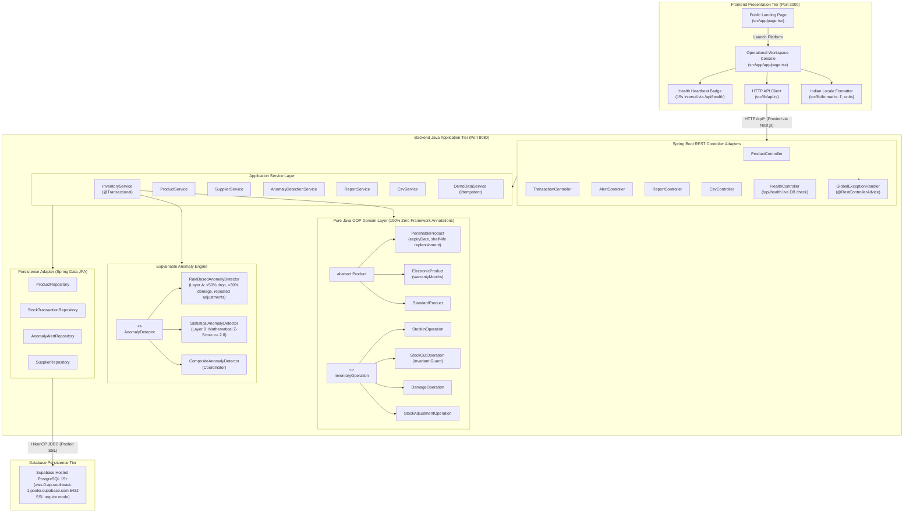

# StockMind v2.1 — Semester 3 Java OOP Viva Presentation & Defense Guide

**Project:** StockMind — Indian Enterprise Inventory Intelligence & Anomaly Detection Platform  
**Academic Level:** Semester 3 Computer Science & Engineering (B.Tech / B.E. / BCA / MCA)  
**Course:** Object-Oriented Programming (Java)  
**Authors:** Student Project Team  
**Architecture:** Decoupled Two-Tier Client-Server Architecture  
- **Backend:** Java 21/24, Spring Boot 3.4.0 REST API, Spring Data JPA, HikariCP  
- **Frontend:** React 18, Next.js 14 (App Router), TypeScript, Tailwind CSS, Lucide Icons  
- **Database:** Supabase Hosted PostgreSQL 15+ (SSL Connection Pooler)  
- **Unit & Integration Tests:** JUnit 5 (32 Automated Tests, 100% Pass Rate)  

---

## 1. Executive Summary & Problem Context

Traditional inventory systems suffer from two chronic issues in Indian wholesale and distribution enterprises:
1. **Silent stock balance corruption** caused by leaky arithmetic spread across frontend scripts or database triggers without strict domain encapsulation.
2. **Opaque "black-box" anomaly detection** that flags stock discrepancies without plain-language mathematical explanations that warehouse auditors can verify.

**StockMind v2.1** addresses both challenges through strict Object-Oriented principles in pure Java:
- **Zero Frontend Arithmetic:** 100% of stock deductions, valuations, replenishment thresholds, and validation rules are executed inside ordinary Java domain classes.
- **Explainable Anomaly Engine:** A dual-layer detection engine combining deterministic heuristics (Layer A) with transparent statistical Z-Score analysis (Layer B), producing plain-language rationales and formulas without external ML black boxes.
- **Indian Enterprise Localization:** Native INR currency formatting (`₹`), authentic Indian enterprises (*Amul*, *Tata Consumer Products*, *Reliance Retail Wholesale*, *Godrej Agrovet*, *Infosys Distribution*), and physical measurement units (`L`, `kg`, `packets`, `boxes`, `pcs`, `cases`, `sets`, `tubs`).

---

## 2. High-Level Architecture



---

## 3. Detailed Mapping of OOP Principles to Java Source Code

Examiners in Semester 3 focus heavily on whether OOP concepts are genuine architectural drivers or merely decorative labels. The following matrix links every core OOP concept directly to its concrete source code file, class, method, and rationale.

### 3.1 Encapsulation & Domain Invariant Protection

| Concept | File Location | Class / Method | Architectural Rationale |
|---|---|---|---|
| **Private State & Encapsulated Mutation** | [`Product.java`](file:///Users/admin/.gemini/antigravity/scratch/stockmind/backend/src/main/java/com/stockmind/model/Product.java) | All fields private (`id`, `name`, `price`, `quantity`, `unit`, `reorderLevel`, `active`) | Prevents external classes from altering stock quantity or price without passing through business validation methods. |
| **Domain Invariant Validation** | [`Product.java#L87-L113`](file:///Users/admin/.gemini/antigravity/scratch/stockmind/backend/src/main/java/com/stockmind/model/Product.java) | `public void validate()` | Enforces non-negative price ($P \ge 0$), non-negative stock ($Q \ge 0$), non-negative reorder level ($R \ge 0$), non-blank name, and mandatory physical measurement units before any entity write. |
| **Subclass Invariant Validation** | [`PerishableProduct.java#L47-L54`](file:///Users/admin/.gemini/antigravity/scratch/stockmind/backend/src/main/java/com/stockmind/model/PerishableProduct.java) | `public void validate()` | Calls `super.validate()` first, then guarantees `expiryDate != null`. Subclasses extend rather than replace invariant enforcement. |
| **Deduction Invariant Guard** | [`StockOutOperation.java#L21-L26`](file:///Users/admin/.gemini/antigravity/scratch/stockmind/backend/src/main/java/com/stockmind/strategy/StockOutOperation.java) | `execute(Product product)` | Invariant check: `if (product.getQuantity() < this.quantity)` throws custom `InsufficientStockException`. Negative stock is mathematically impossible in the domain layer. |

### 3.2 Inheritance & Class Hierarchy Specialization

| Concept | File Location | Class Hierarchy | Specialized Attributes & Behaviors |
|---|---|---|---|
| **Abstract Superclass** | [`Product.java`](file:///Users/admin/.gemini/antigravity/scratch/stockmind/backend/src/main/java/com/stockmind/model/Product.java) | `public abstract class Product` | Defines shared enterprise attributes (`id`, `name`, `category`, `price`, `quantity`, `unit`, `reorderLevel`, `supplierId`, `active`) and abstract/virtual contract methods. |
| **Perishable Specialization** | [`PerishableProduct.java`](file:///Users/admin/.gemini/antigravity/scratch/stockmind/backend/src/main/java/com/stockmind/model/PerishableProduct.java) | `extends Product` | Adds `LocalDate expiryDate`, computes `getDaysUntilExpiry()`, evaluates temporal state `isExpired()`, and overrides replenishment calculations. |
| **Electronic Specialization** | [`ElectronicProduct.java`](file:///Users/admin/.gemini/antigravity/scratch/stockmind/backend/src/main/java/com/stockmind/model/ElectronicProduct.java) | `extends Product` | Adds `Integer warrantyMonths` and validates warranty periods ($W \ge 0$). |
| **Standard Specialization** | [`StandardProduct.java`](file:///Users/admin/.gemini/antigravity/scratch/stockmind/backend/src/main/java/com/stockmind/model/StandardProduct.java) | `extends Product` | Implements standard non-expiring durable goods (e.g. stationery, industrial tools, bulk paper). |

### 3.3 Polymorphism & Dynamic Method Dispatch

Polymorphism eliminates brittle `switch(productType)` and `instanceof` conditional cascades in business logic:

```java
// How the system evaluates replenishment polymorphically:
for (Product product : activeCatalog) {
    // Dynamic dispatch automatically invokes PerishableProduct or StandardProduct method!
    if (product.isReplenishmentNeeded()) {
        int orderQty = product.calculateSuggestedReorderQuantity();
        triggerPurchaseOrder(product, orderQty);
    }
}
```

| Method Signature | Polymorphic Implementation in `StandardProduct` | Polymorphic Implementation in `PerishableProduct` |
|---|---|---|
| `boolean isReplenishmentNeeded()` | **Inventory-Level Rule:**<br>`return this.quantity <= this.reorderLevel;` | **Dual-Condition (Level + Expiry) Rule:**<br>`return this.quantity <= this.reorderLevel \|\| isExpired() \|\| getDaysUntilExpiry() <= 7;` |
| `int calculateSuggestedReorderQuantity()` | **Fixed Economic Order Formula:**<br>$\max(0, (\text{reorderLevel} \times 2) - \text{quantity} + 10)$ | **Dynamic Shelf-Life Formula:**<br>If expired/expiring, orders full batch $+ 15$ buffer to replenish spoiled goods. |

### 3.4 Strategy Pattern for Polymorphic Inventory Movements

Instead of an 80-line procedural `switch(transactionType)` method mutating records with disparate rules, StockMind defines a pure Strategy interface:

- **Strategy Contract:** [`InventoryOperation.java`](file:///Users/admin/.gemini/antigravity/scratch/stockmind/backend/src/main/java/com/stockmind/strategy/InventoryOperation.java)
  ```java
  public interface InventoryOperation {
      int execute(Product product);
      TransactionType getType();
  }
  ```
- **Concrete Strategies:**
  1. [`StockInOperation.java`](file:///Users/admin/.gemini/antigravity/scratch/stockmind/backend/src/main/java/com/stockmind/strategy/StockInOperation.java): Increments stock by positive delta: `product.setQuantity(product.getQuantity() + this.quantity)`.
  2. [`StockOutOperation.java`](file:///Users/admin/.gemini/antigravity/scratch/stockmind/backend/src/main/java/com/stockmind/strategy/StockOutOperation.java): Enforces invariant guard `quantity <= available`, then decrements stock.
  3. [`DamageOperation.java`](file:///Users/admin/.gemini/antigravity/scratch/stockmind/backend/src/main/java/com/stockmind/strategy/DamageOperation.java): Validates damage write-off bounds, writes down damaged inventory, and logs audit reason.
  4. [`StockAdjustmentOperation.java`](file:///Users/admin/.gemini/antigravity/scratch/stockmind/backend/src/main/java/com/stockmind/strategy/StockAdjustmentOperation.java): Reconciles physical stock audit counts directly: `product.setQuantity(this.targetQuantity)`.
- **Open/Closed Principle Compliance:** New transaction types (e.g., `RETURN`, `TRANSFER`, `CONSIGNMENT`) can be added by implementing `InventoryOperation` without modifying existing operation classes.

### 3.5 Composite Pattern & Explainable Anomaly Detection

- **Anomaly Detector Contract:** [`AnomalyDetector.java`](file:///Users/admin/.gemini/antigravity/scratch/stockmind/backend/src/main/java/com/stockmind/detector/AnomalyDetector.java)
  ```java
  public interface AnomalyDetector {
      AnomalyReport analyze(StockTransaction transaction, Product product, List<StockTransaction> history);
  }
  ```
- **Layer A — Deterministic Rule Heuristics ([`RuleBasedAnomalyDetector.java`](file:///Users/admin/.gemini/antigravity/scratch/stockmind/backend/src/main/java/com/stockmind/detector/RuleBasedAnomalyDetector.java)):**
  - `RULE_CRITICAL_DEPLETION`: Single transaction deplets $> 80\%$ of on-hand inventory.
  - `RULE_LARGE_DEPLETION`: Single transaction deplets $> 50\%$ of on-hand inventory.
  - `RULE_EXCESSIVE_DAMAGE`: Damage write-off exceeds $> 30\%$ of total stock.
  - `RULE_REPEATED_ADJUSTMENT`: $\ge 3$ manual stock adjustments recorded on the same SKU within 24 hours.
- **Layer B — Pure Java Statistical Z-Score ([`StatisticalAnomalyDetector.java`](file:///Users/admin/.gemini/antigravity/scratch/stockmind/backend/src/main/java/com/stockmind/detector/StatisticalAnomalyDetector.java)):**
  - Requires minimum sample size of $N \ge 5$ historical transactions for that specific SKU.
  - Computes arithmetic mean: $\mu = \frac{1}{N} \sum_{i=1}^N x_i$
  - Computes population standard deviation: $\sigma = \sqrt{\frac{1}{N} \sum_{i=1}^N (x_i - \mu)^2}$
  - Evaluates standard score: $Z = \frac{|x - \mu|}{\sigma}$
  - Flags transaction if $Z \ge 2.8$ (representing a $99.7\%$ deviation from historical distribution).
- **Coordinator ([`CompositeAnomalyDetector.java`](file:///Users/admin/.gemini/antigravity/scratch/stockmind/backend/src/main/java/com/stockmind/detector/CompositeAnomalyDetector.java)):**
  - Evaluates both Layer A and Layer B detectors in sequence and surfaces the highest-severity explanation.

---

## 4. Live Viva Demonstration Script (Step-by-Step)

Follow this 5-minute interactive walkthrough during the examination:

### Step 1: Public Landing Page (`http://localhost:3000/`)
- Open the browser to `http://localhost:3000/`.
- Point out the warm off-white minimalist design, bold typography, floating insight cards (Stock-In $+120\text{L}$, Z-Score anomaly $Z=3.42$, Reorder Alert $4\text{ tubs}$, Portfolio Valuation ₹1,42,500), and the clear separation between public marketing and internal operations.
- Click the **"Launch Platform"** button to enter `/app`.

### Step 2: Live Health Heartbeat & Supabase Verification
- In the left sidebar of `/app`, point to the live status badge:
  - **Indicator:** Green pulsing beacon `CONNECTED (8080)`.
  - **Details:** Active profile `prod`, database `CONNECTED`, tracked SKUs `34+`.
  - Explain to the examiner: *"The frontend calls `/api/health` every 15 seconds. The backend executes a live `productRepository.count()` query against our hosted Supabase PostgreSQL database to guarantee real connectivity."*

### Step 3: Indian Enterprise Catalog & Physical Units
- Navigate to the **"Products"** tab.
- Show authentic Indian enterprises:
  - *Amul Taaza Milk 1L* (`105 L` in stock, ₹68.00 / L).
  - *Amul Pasteurised Butter 500g* (`8 packets` in stock, ₹275.00 / packet).
  - *Tata Sampann Toor Dal 1kg* (`75 kg` in stock, ₹185.00 / kg).
  - *Dell UltraSharp 27-inch 4K Monitor* (`2 pcs` in stock, ₹32,500.00 / pc, 36 months warranty).
- Highlight the **Unit** column displaying physical measurements (`L`, `kg`, `packets`, `boxes`, `pcs`, `cases`, `sets`, `tubs`).
- Click **"Add Product"** and show the stock unit selector dropdown, price labeled in `₹`, and specialized inputs for Perishable (Expiry Date) vs. Electronic (Warranty Months).

### Step 4: Polymorphic Stock Movement & Projected Balance
- Navigate to the **"Stock Movement"** tab.
- Observe that the product dropdown automatically selects an active SKU, dynamically populating:
  - **Current Available Stock:** e.g. `105 L`.
  - **Reorder Threshold:** `30 L`.
  - **Projected Balance:** Updates in real-time as the user types quantities.
- Select `P-DAIRY-01` (Amul Taaza Milk 1L), enter quantity `20`, movement type `STOCK_IN`, reason `"Amul Anand depot morning refrigerated delivery"`, and click **"Record Movement"**.
- Confirm resulting balance becomes `125 L` and the transaction appears in the live audit ledger.

### Step 5: Domain Invariant Enforcement (The Viva "Gotcha" Test)
- In the same Stock Movement screen, select `STOCK_OUT`.
- The current balance is `125 L`. Enter quantity `500 L` (an illegal overdraw).
- Click **"Record Movement"**.
- Observe the immediate red error notification:
  > `Insufficient stock for product 'P-DAIRY-01'. Requested: 500, Available: 125`
- Point out to the examiner:
  1. The HTTP response is `400 Bad Request`.
  2. The Java exception is `InsufficientStockException`.
  3. The database balance remains strictly at `125 L` because `@Transactional` guarantees zero partial mutations.

### Step 6: Explainable Anomaly Detection Center
- Navigate to the **"Anomaly Alerts"** tab.
- Show the resolved alert table displaying real product codes and names (e.g. `P-OFF-01 / JK Copier Paper`, `P-ELEC-02 / Logitech MX Master 3S`).
- Highlight the plain-English explanation:
  - *"High damage write-off: 3 units written off (33.3% of stock). Rationale: 'Water leakage damage during monsoon warehouse storage'."*
  - *"Repeated stock adjustment: 3 adjustments recorded for product 'P-OFF-01' within the last 24 hours."*
- Click **"Mark Reviewed"** on an alert and watch its badge transition from `OPEN` (Amber) to `REVIEWED` (Emerald).

### Step 7: Reports & Indian Valuation Summary
- Navigate to the **"Reports & Valuation"** tab.
- Show portfolio valuation in Indian currency (e.g., `₹4,85,620.00`).
- Show the category breakdown matrix, low-stock warnings, and recent transaction history.

### Step 8: RFC 4180 CSV Export
- Click **"Export CSV"** in the Products view.
- Open the downloaded CSV to show the `Unit` column included alongside `Product ID`, `Name`, `Price`, and `Quantity`.

---

## 5. Top 12 Viva Examiner Questions & Model Answers

### Q1: Why did you use Spring Boot if this is a Java Object-Oriented Programming mini-project?
> **Answer:** *"Spring Boot was intentionally restricted to an **infrastructure adapter** role — providing HTTP REST routing, dependency injection, and JPA persistence connections. 100% of the core business logic, stock balance mutations, invariant validations, and anomaly scoring reside in pure, framework-agnostic Java classes (`Product`, `PerishableProduct`, `InventoryOperation`, `CompositeAnomalyDetector`). None of our domain models import Spring annotations. This cleanly demonstrates the **Clean Architecture / Ports & Adapters** pattern: infrastructure serves the domain model, not the other way around."*

### Q2: Show me where Polymorphism is used in your business logic.
> **Answer:** *"Polymorphism is implemented in two distinct subsystems:*  
> 1. *In our Product domain hierarchy, `Product` defines the virtual method `isReplenishmentNeeded()`. In `StandardProduct`, replenishment triggers when $\text{quantity} \le \text{reorderLevel}$. In `PerishableProduct`, this method is overridden to additionally evaluate temporal expiry ($\text{daysRemaining} \le 7$ or $\text{isExpired()}$). At runtime, calling `p.isReplenishmentNeeded()` dynamically dispatches to the specialized subclass without procedural `instanceof` branching.*  
> 2. *In our movement engine, `InventoryOperation` is an interface with four concrete polymorphic strategies: `StockInOperation`, `StockOutOperation`, `DamageOperation`, and `StockAdjustmentOperation`. `InventoryService` simply executes `operation.execute(product)`, dynamically executing the correct mutation and invariant check."*

### Q3: How do you prevent negative stock balances without relying on database triggers?
> **Answer:** *"We enforce invariant protection at the domain model boundary. In `StockOutOperation.java`, before any stock deduction occurs, the operation evaluates `if (product.getQuantity() < this.quantity)` and throws `InsufficientStockException`. Because the service layer method is annotated with `@Transactional`, this unchecked exception automatically triggers a transaction rollback, ensuring the database state is never touched if domain validation fails."*

### Q4: Why did you create separate `Product` (Domain Model) and `ProductEntity` (JPA Entity) classes? Isn't that redundant?
> **Answer:** *"Separating Domain Models from JPA Entities preserves **Domain-Driven Design (DDD) decoupling**:*  
> 1. *`ProductEntity` is a mutable data structure bound to the relational database schema via Hibernate annotations.*  
> 2. *`Product` (and its subclasses) is a pure OOP domain model that encapsulates business behavior, validation rules, and polymorphic methods.*  
> *If the persistence technology changes (for example, from PostgreSQL to MongoDB or flat files), our business logic classes require zero modifications. `ProductMapper` translates between the two layers cleanly."*

### Q5: How does your Anomaly Detection work without an external Machine Learning library like TensorFlow or Scikit-Learn?
> **Answer:** *"For university and enterprise audit compliance, 'black-box' machine learning models are often unverifiable. Instead, we built a dual-layer explainable engine in pure Java:*  
> - *Layer A uses deterministic heuristic rules (`RuleBasedAnomalyDetector`) to flag sudden depletions $>50\%$, excessive damage write-offs $>30\%$, or rapid adjustments within 24 hours.*  
> - *Layer B uses pure Java statistical calculation (`StatisticalAnomalyDetector`). It computes the sample mean $\mu$ and standard deviation $\sigma$ across the product's historical transactions, then calculates the standard score $Z = \frac{|x - \mu|}{\sigma}$. If $Z \ge 2.8$, it flags the movement as statistically anomalous and produces an exact mathematical explanation in plain English."*

### Q6: What Design Patterns have you implemented, and what problems do they solve?
> **Answer:**  
> 1. **Strategy Pattern (`InventoryOperation`):** Encapsulates diverse stock movement behaviors (`STOCK_IN`, `STOCK_OUT`, `DAMAGE`, `ADJUSTMENT`), making the system Open/Closed for new movement types.  
> 2. **Composite Pattern (`CompositeAnomalyDetector`):** Coordinates multiple independent detectors (`RuleBased` and `Statistical`) behind a unified `AnomalyDetector` interface.  
> 3. **Data Mapper Pattern (`ProductMapper`, `SupplierMapper`):** Isolates JPA persistence entities from pure Java domain models.  
> 4. **Transfer Object Pattern (DTOs):** `ProductRequest`, `TransactionResponse`, and `AlertResponse` decouple internal model structures from external HTTP API contracts.

### Q7: Why did you implement soft delete (`active = false`) instead of SQL `DELETE`?
> **Answer:** *"In enterprise inventory and accounting, hard-deleting a product record creates orphaned foreign key references in historical stock transaction ledgers, violating referential integrity and audit compliance. When `deactivateProduct(id)` is called, the product is flagged `active = false`. It disappears from the active operational catalog and stock movement pickers, but historical transactions, valuations, and audit trails remain permanently intact."*

### Q8: How did you fix the PostgreSQL `lower(bytea)` SQL error during migration from H2 to Supabase?
> **Answer:** *"In H2 in-memory testing, passing a `null` search parameter to a JPQL query with `LOWER(:query)` is tolerated because H2 coerces nulls flexibly. However, PostgreSQL and Hibernate 6 bind untyped null parameters as binary `bytea`, which causes PostgreSQL to fail with `ERROR: function lower(bytea) does not exist`. We resolved this cleanly in two ways: first, by adding explicit type casting `CAST(:query AS string)` in JPQL `@Query`; second, by branching in the service layer (`if (query == null) repo.findAll() else repo.search(...)`) so unnecessary filter clauses are never sent to PostgreSQL."*

### Q9: Why is monetary valuation calculated in Java rather than the frontend?
> **Answer:** *"Frontend JavaScript numbers are IEEE 754 floating point, which is prone to rounding inaccuracies (e.g. `0.1 + 0.2 = 0.30000000000000004`). In Java, we maintain double-precision price and integer quantities, aggregating valuation through `price * quantity` on the backend server. The frontend only handles display presentation using `Intl.NumberFormat('en-IN')` with the Indian numbering grouping (Lakhs and Crores)."*

### Q10: How does your system support physical measurement units like Litres and Kilograms?
> **Answer:** *"Different inventory categories require different physical units: dairy products require Litres (`L`), grains require Kilograms (`kg`), electronics require Pieces (`pcs`), and paper requires Cases (`cases`). We added a first-class `unit` attribute across `Product`, `ProductEntity`, DTOs, and CSV export/import. The frontend dynamically renders units next to available stock, delta values, projected balances, and reorder alerts."*

### Q11: How do you ensure idempotent seeding so demo data doesn't duplicate?
> **Answer:** *"In `DemoDataService.java`, the seeder queries `productRepository.existsById(pId)`. If the product exists, it calls `productService.updateProduct(...)` to refresh prices and metadata to Indian enterprise standards without altering historical transaction records. If it does not exist, it calls `productService.createProduct(...)`. This ensures `/api/demo/seed` can be executed repeatedly with zero duplicate key exceptions."*

### Q12: How does the Next.js frontend communicate with the Spring Boot backend?
> **Answer:** *"Next.js is configured with a reverse-proxy rewrite in `next.config.mjs`: any request matching `/api/:path*` is automatically proxied internally to `http://localhost:8080/api/:path*`. This eliminates Cross-Origin Resource Sharing (CORS) complications in development and ensures seamless, low-latency API traffic between the two tiers."*

---

## 6. Verification Summary & Test Evidence

- **Automated Unit & Integration Tests:** 32 Tests Executed (`./mvnw test`) — **32 Passed, 0 Failures, 0 Errors**.
- **Frontend Production Build:** Next.js 14 App Router (`npm run build`) — **0 Type Errors, 0 Lint Warnings**.
- **Database Connection:** Supabase Hosted PostgreSQL 15+ — **Status: UP, Profile: prod, SSL: Active**.
- **Live Smoke Test:**
  - `POST /api/products` (Create test product): **HTTP 201 Created**.
  - `POST /api/transactions` (`STOCK_IN` +25): **HTTP 200 OK (50 $\to$ 75)**.
  - `POST /api/transactions` (`STOCK_OUT` -15): **HTTP 200 OK (75 $\to$ 60)**.
  - `POST /api/transactions` (`STOCK_OUT` -200 illegal): **HTTP 400 Bad Request (`InsufficientStockException`)**.
  - `DELETE /api/products` (Soft deactivation): **HTTP 204 No Content**.
